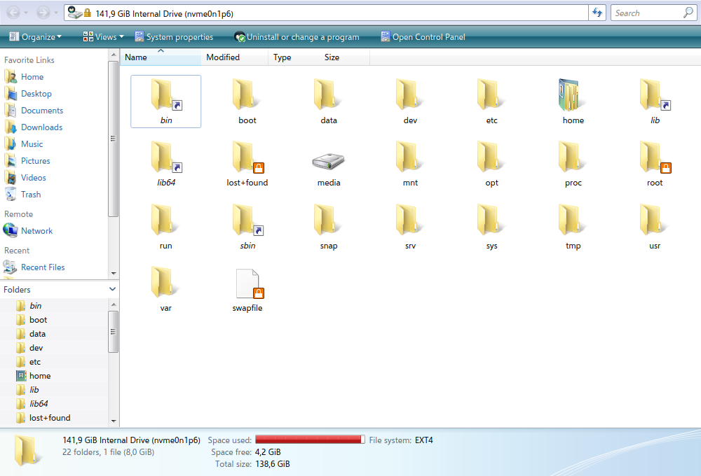
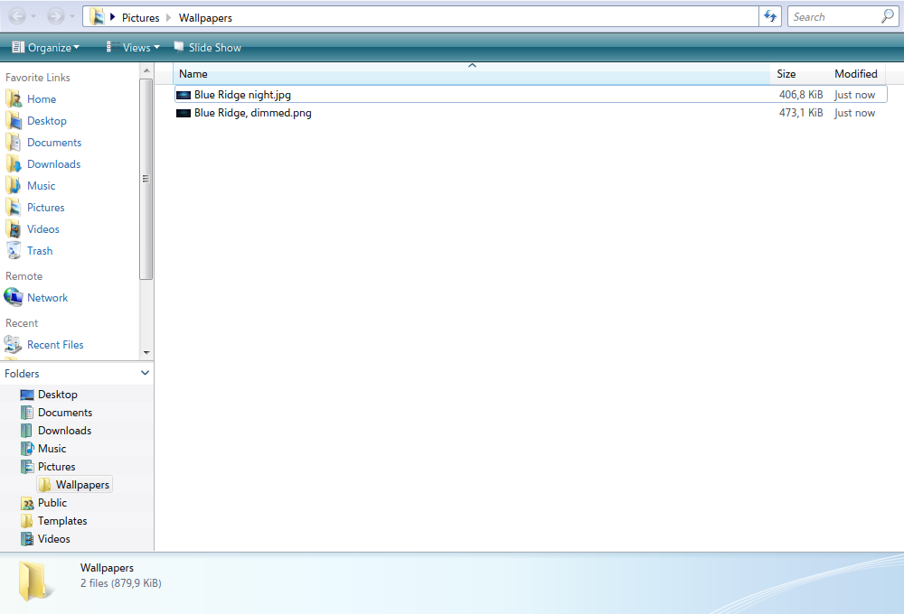
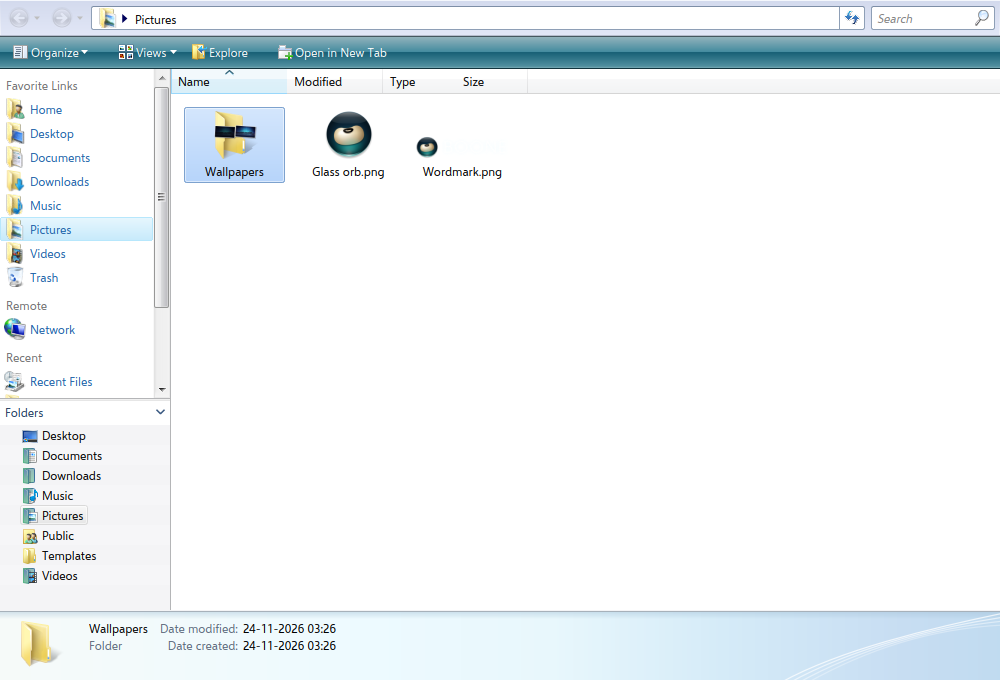

# Vista Dolphin

KDE's Dolphin file manager, made to look and work like **Windows Vista's Explorer**. This is a
fork of [Dolphin](https://invent.kde.org/system/dolphin) 25.12.3; every change is in its own
commit on the `vista-explorer` branch.



| Details view | Context tasks for a selected folder |
|---|---|
|  |  |

## What is different

- **Address bar row:** Back and Forward, the breadcrumb with Vista's regular-weight crumbs,
  Refresh joined to the address field, and Vista's search box next to it.
- **Command bar** under the address bar, with Vista's teal gradient:
  - an **Organize** menu, as in Vista: New Folder, Cut, Copy, Paste, Undo, Select All, Layout,
    Folder and Search Options, Delete, Rename, Properties and Close;
  - a **Views** button that cycles List, Details, Tiles and Large Icons;
  - **context tasks** that change with the folder and the selection, e.g. Slide Show,
    E-mail, Set as Desktop Background, Explore, Empty Recycle Bin.
- **Navigation pane:** *Favorite Links* above a collapsible *Folders* tree, with Vista's
  colours and capacity bars for drives.
- **Details Pane** along the bottom: an icon, the name, and facts about the selection or the
  folder, including drive usage bars.
- **Column headers in every view**, with Vista's header style and sort chevrons.
- **Vista's selection and hover colours and padding**, and no striped rows in Details.
- **Tabs** spaced and styled like Vista.
- **Control Panel links** (System properties, Uninstall a program, Folder Options) when
  [Vista Control Panel](https://github.com/ChivanCOM/vista-control-panel) is installed.

The look is meant for a Vista-styled Plasma desktop such as
[VistaThemePlasma](https://gitgud.io/aeroshell/vtp/vistathemeplasma) with its Kvantum theme.
On other themes the layout still works, but colours will not match.

## Build and install

You need the same build dependencies as Dolphin 25.12 (on Debian/Ubuntu:
`sudo apt build-dep dolphin`, or install the KF6 development packages).

```sh
git clone -b vista-explorer https://github.com/ChivanCOM/vista-dolphin.git
cmake -S vista-dolphin -B build -G Ninja -DCMAKE_BUILD_TYPE=Release -DBUILD_TESTING=OFF \
      -DCMAKE_INSTALL_PREFIX=/usr/local
ninja -C build
sudo ninja -C build install
```

This replaces the `dolphin` command when /usr/local/bin comes first in your PATH (it does on
most distributions). To go back, run `sudo ninja -C build uninstall` or remove the files listed in
`build/install_manifest.txt`.

What gets installed besides the program:

| File | Purpose |
|---|---|
| `<datadir>/vista-dolphin/explorer.qss` | style sheet for the command bar, address field, search box and tabs |
| `<datadir>/kxmlgui5/dolphin/dolphinui.rc` | Explorer's toolbar layout |
| `<sysconfdir>/xdg/dolphinrc` | Explorer's default window layout (your own settings still win); leave it out with `-DVISTA_INSTALL_DEFAULTS=OFF` |

Set `DOLPHIN_VISTA=0` to turn off the Vista painting: the style sheet, the selection, header
and tab drawing, and the breadcrumb tweaks. The Vista layout stays: the panes, the Organize and
Views menus, the command bar and the search box. Build upstream Dolphin for the stock layout.

## Updating to a newer Dolphin

The Vista changes are plain commits on top of an upstream tag, so moving to a newer Dolphin
release is a rebase:

```sh
git fetch https://invent.kde.org/system/dolphin.git --tags
git rebase --onto v<new> v25.12.3 vista-explorer
```

Most of the new code lives in `src/vista/`. Changes to Dolphin's own files are kept small and
tagged with `// Vista:` comments.

## Credits and license

- Dolphin is by the KDE community. This fork is not affiliated with or endorsed by KDE.
- Written for **BOONE**, a personal Vista-style Ubuntu remix, and released as a standalone project.
- Windows and Windows Vista are trademarks of Microsoft. This project is not affiliated
  with or endorsed by Microsoft.
- License: like Dolphin, GPL-2.0-or-later (see `LICENSES/`).

Please report problems with the Vista changes
[here](https://github.com/ChivanCOM/vista-dolphin/issues), not to KDE.

---

## Upstream Dolphin README

Dolphin is KDE's file manager that lets you navigate and browse the contents of your hard drives, USB sticks, SD cards, and more. Creating, moving, or deleting files and folders is simple and fast. See more information [on Dolphin's homepage](https://apps.kde.org/dolphin/).


### User Documentation

See https://userbase.kde.org/Special:myLanguage/Dolphin.

### Contributing

Like other projects in the KDE ecosystem, contributions are welcome from all. This repository is managed in [KDE Invent](https://invent.kde.org/system/dolphin), our GitLab instance.

* Want to contribute code? See the [GitLab wiki page](https://community.kde.org/Infrastructure/GitLab) for a tutorial on how to send a merge request.
* Reporting a bug? Please submit it on the [KDE Bugtracking System](https://bugs.kde.org/enter_bug.cgi?format=guided&product=dolphin). Please do not use the Issues
tab to report bugs.
* Is there a part of Dolphin that's not translated? See the [Getting Involved in Translation wiki page](https://community.kde.org/Get_Involved/translation) to see how
you can help translate!

If you get stuck or need help with anything at all, head over to the [KDE New Contributors room](https://go.kde.org/matrix/#/#kde-welcome:kde.org) on Matrix. For questions about Dolphin, please ask in the [KDE File Management room](https://go.kde.org/matrix/#/#kde-fm:kde.org). See [Matrix](https://community.kde.org/Matrix) for more details.

### Development Philosophy

Dolphin is a file manager focusing on usability. When reading the term Usability people often assume that the focus is on newbies and only basic features are offered. This is not the case; Dolphin is quite full-featured, but the features are carefully chosen so as to not impede any of the users in the target user groups.

### Target User Groups

Focusing on usability means that features are discoverable and efficient to use. The feature set is defined indirectly by the target user group of Dolphin:

- **Lisa**: Lisa has been familiar with computers for 10 years. From her job, she has experience with Word, Excel and Outlook. At home she mainly uses the computer for browsing the web and writing e-mails. She requires a file manager for managing photos from the camera, documents she gets via e-mail, or PDFs she downloads with a browser. Lisa knows concepts like folders and a file hierarchy, but she is not familiar with the file hierarchy of Linux.

- **Simon**: Simon has been a developer at a software company for 8 years. At home he uses a file manager to maintain his large collection of photos and music. Additionally he owns a small homepage and needs to transfer updated files on the FTP server. Moving and copying files are regular tasks in Simon's workflow.

Not part of the target user group of Dolphin are Fred and Jeff:

- **Fred**: Fred is 75 years old and is able to write e-mails and browsing the web. He is not familiar with file hierarchies and stores all his documents on the desktop.

- **Jeff**: Jeff is Linux-freak since the age of 16 a few years ago. He is a developer and in his spare time he acts as administrator for a small company. Jeff has two monitors to keep the overview about his huge number of opened applications.

This does not mean that Fred or Jeff cannot work with Dolphin. But there might be features and concepts of Dolphin that overburden Fred. Also Jeff might miss some features which are a must-have for his daily work. This is acceptable; there are other tools that cater specifically to their needs.

### Non-Intrusive Features

Before a feature is added in Dolphin, check whether the feature is mandatory for the target user group. If this is not the case, then this does not mean that the feature cannot be added; first it must be clarified whether the feature might be non-intrusive, so that it adds value for users outside the primary target user group of Dolphin. The term "non-intrusive" is mainly related to the user interface. A feature that adds a lot of clutter to the main menu, context menus or toolbar might harm the target user group. In this case the feature should not be added.

A good example of a feature that is non-intrusive is the embedded terminal in Dolphin. It only requires one entry inside a sub-menu, but adds great value for Jeff, who is not part of the target user group.

### Options

Options are mandatory as the "average Joe" user does not exist. Still it is not the goal of Dolphin to offer options for all kind of things. Again the focus is on the possible needs of the target user group. Each additional option makes it harder finding other options, so the same rules for features are applied to options too.
